<div align="center">

<h1 align="center">基于 K1 MUSE Pi Pro 的端侧 AI 智能药盒与用药推理闭环系统</h1>

**面向居家老人及病房多药管理，集药品录入、方案辅助、药仓执行与服药核验于一体。**

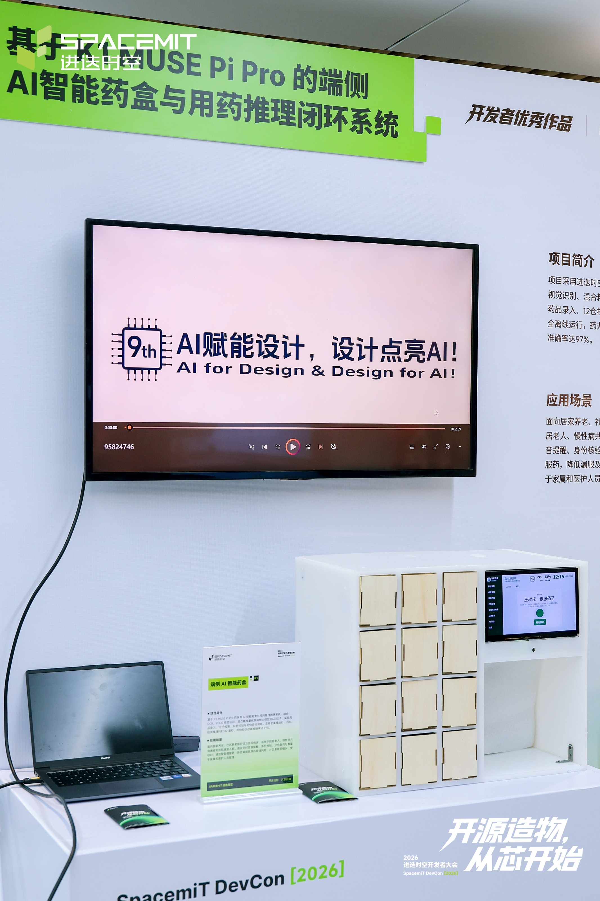

*展会现场样机照片*

</div>

## 项目简介

本项目基于进迭时空 **K1 MUSE Pi Pro** 开发，整机约 **55 × 45 × 30 cm**，采用 PP 板结构，集成 12 个独立电控药仓、闭合状态反馈、10 英寸触控屏、双摄像头、USB 麦克风和 USB 扬声器。系统把药品资料录入、用药方案生成、药品入仓、到点提醒、身份核验、取药数量检查和记录反馈连成一套端侧工作流。

药单可由本地 OCR 识别，也可手动录入并由用户确认；方案生成结合本地药品说明书、药物相互作用数据、标准服药规则和个人作息，通过“**规则索引 + 端侧大模型推理 + 程序校验**”给出可解释、可编辑的建议。放药时识别药盒并匹配已录入药品，安排仓位并引导入仓；服药时进行语音提醒和本地人脸核验，配合视觉识别及仓门反馈记录取药结果。用户还可通过触控、语音或药盒图像发起药物咨询，并使用联网语音合成播报中文答复。

> 用药方案和药物问答用于信息辅助，不替代医生或药师判断。涉及处方、剂量、禁忌或身体不适时，应由专业人员复核。

## 系统功能

| 环节 | 功能 | 输入与输出 |
| ---  | --- | --- |
| 药品录入  | 药单本地 OCR、字段整理、手动编辑与确认 | 处方图片 → 待确认的结构化药品条目 |
| 方案辅助  | 规则检索、相互作用检查、端侧模型解释与程序校验 | 成员资料、药品与作息 → 可编辑的服药安排和提示 |
| 药品入仓  | 药盒 OCR 匹配、仓位分配、弹仓引导、关门反馈 | 已确认药品 → 入仓步骤和仓门状态 |
| 服药核验  | 语音提醒、人脸核验、药品/数量视觉核对 | 服药计划 → 取药结果、异常提示和记录 |
| 药物咨询  | 触控、语音或图像提问，本地知识检索与端侧推理 | 用户问题 → 中文解释 |
| 记录反馈  | 提醒、身份核验、开关仓和异常事件记录 | 系统事件 → 用药过程记录与依从性数据 |

## 系统架构

系统由多模态输入、K1 端侧智能服务、药仓与交互外设、流程记录四部分构成。OCR、模型和服务的具体依赖见[依赖说明](docs/DEPENDENCIES.md)，完整代码目录见下方[项目结构](#项目结构)。

<p align="center">
  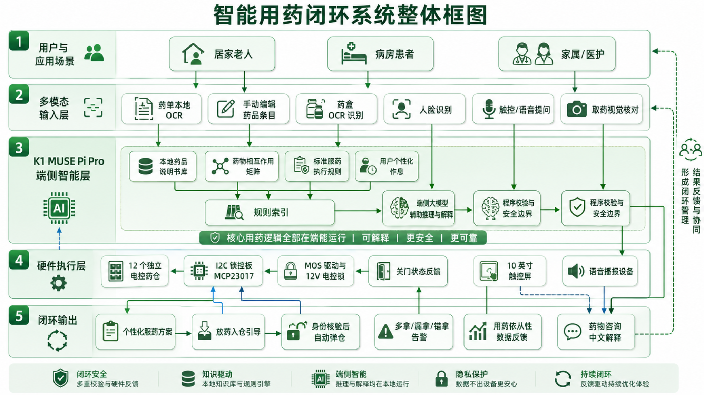
</p>
<p align="center"><em>系统整体框架</em></p>

<details>
<summary>展开查看功能流程图</summary>

<p align="center">
  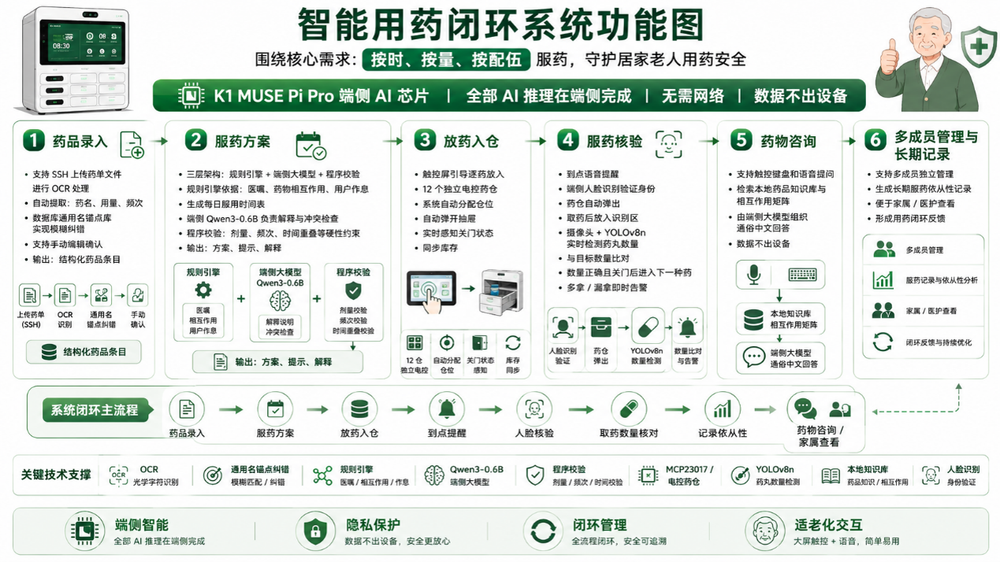
</p>

<p align="center"><em>从药品录入到咨询与长期记录的功能流程</em></p>

<p align="center">
  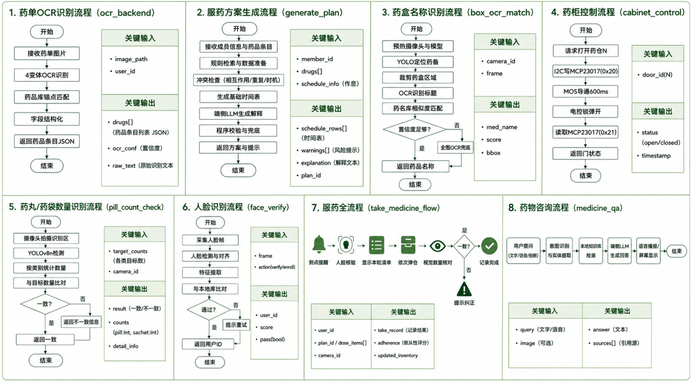
</p>

</details>

## 软件界面

界面包括成员管理、服药方案、药柜管理和智能用药助手等页面。

<p align="center">
  
</p>

<p align="center">
  
</p>

界面图中的姓名、药品和服药信息应作为演示数据使用；公开前请确认均为虚构或已完成匿名化。

## 硬件清单

| 类别 | 硬件 |
| --- | --- |
| 主控 | 进迭时空 K1 MUSE Pi Pro |
| 摄像头 | OV5647、IMX219 |
| 交互 | 10 英寸高清触摸屏、USB 麦克风、USB 扬声器 |
| 药仓执行 | 团队自研 12 路锁控板 PCB；12 个带闭合反馈的 4-pin XH-4Y 电控锁 |
| 供电 | 220 V AC 转 12 V 电源；12 V 转 5 V USB 模块 |
| 连接 | 杜邦线若干；屏幕 HDMI/触摸 USB 线及相机排线 |
| 结构 | PP 板外壳、角码、铜柱、木质药格及配套锁扣 |

<p align="center">
  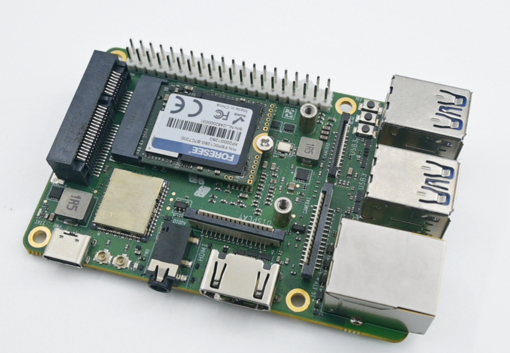
  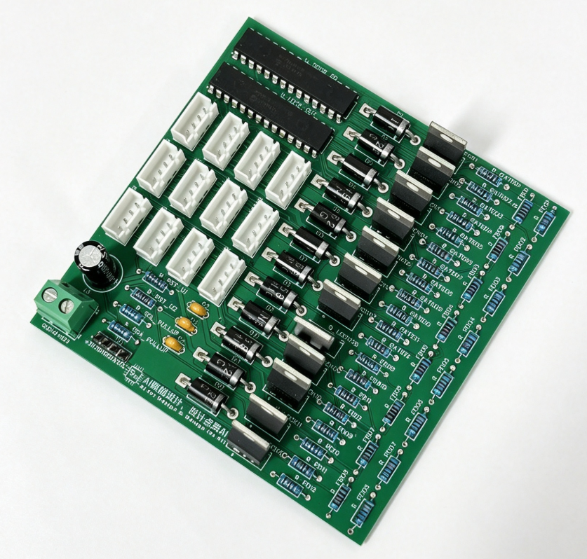
</p>
<p align="center"><em>K1 主控开发板与 12 路锁控板</em></p>

## 外壳制作

外壳目标尺寸约 **55 × 45 × 30 cm**。下面尺寸来自当前项目记录，单位为厘米；下单切割前应使用模型和实物再次核对长宽方向、板厚、开孔位置、装配间隙及材料公差。

### PP 板裁切清单

| 记录尺寸（长 × 宽 × 厚，cm） | 数量 |
| --- | ---: |
| 30 × 54 × 1 | 2 |
| 30 × 45.5 × 1 | 2 |
| 27.5 × 25 × 0.5 | 3 |
| 10.5 × 25 × 1 | 8 |
| 43.5 × 25 × 1.5 | 1 |
| 15 × 23 × 0.5 | 1 |
| 23 × 25 × 1 | 1 |
| 56 × 45.5 × 1 | 1 |

| 部件 | 记录尺寸 | 说明 |
| --- | --- | --- |
| 木质药格 | 8.5 × 10.5 × 15 cm | 草稿记录为单格尺寸；加工前按 12 格布局复核数量和尺寸 |
| PP 板模型 | [`pp板模型.SLDPRT`](pp板模型.SLDPRT) | SolidWorks 零件文件；先确认模型单位、视图和切割商家的文件兼容性 |

前面板与后置板的位置关系见[结构关系图](图片/前面板和后置pp板关系图.png)。如果切割商家不能读取 SolidWorks 文件，请先从原模型导出并校验商家接受的二维图纸格式；不要只凭 README 中的尺寸表直接下单。

### 组装顺序

1. **备料与试装。** 按尺寸表准备 PP 板、角码、PP 胶、铜柱、木质药格、锁扣、电控锁及电气部件。先核对外壳、前面板开孔和屏幕尺寸，再进行粘接或钻孔。
2. **搭建外框。** 用角码将上下底面和左右侧板固定，检查方正度与整体尺寸。
3. **安装前面板。** 将前面板与外框对齐后粘接，胶水固化前保持定位，检查屏幕和 12 个药格开口。
4. **搭建 12 格结构。** 从底部向上逐层安装药格隔板，持续对齐前面板开口，并逐格试装木质药格。
5. **固定主控与显示平台。** 用角码固定 K1 平台；按屏幕安装位置预留角码，使用铜柱安装 10 英寸触摸屏。
6. **安装木格与电控锁。** 拼装木质药格，在后部固定锁扣和电控锁。逐格检查锁舌位置、弹开行程和关门反馈，再永久固定。
7. **安装供电与锁控板。** 将锁控板、电源和 12 V 转 5 V 模块固定在后部，整理走线并留出检修空间。固定方式应确保绝缘、散热和机械强度。
8. **安装摄像头。** 将 OV5647 固定在药品识别区上方；将 IMX219 固定在前面板预留位置。相机排线按 K1 板卡接口方向插接，断电后操作。
9. **连接屏幕和 USB 外设。** 屏幕 HDMI 接 K1 显示输出，触摸数据线接 K1 USB；屏幕 5 V 供电由合适的降压模块提供。USB 麦克风和扬声器接入 K1。
10. **连接锁控板并逐路测试。** 按锁控板原理图和对应版本的 K1 40-pin 接口定义连接 I²C/供电/地线，先确认逻辑电平及电源隔离，再逐路测试开锁和关门反馈。

<details>
<summary>展开查看外壳与安装过程照片</summary>

| 外框与药格 | 木格和电控锁 |
| --- | --- |
| 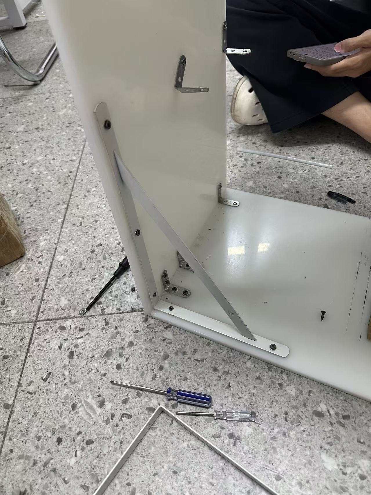 | 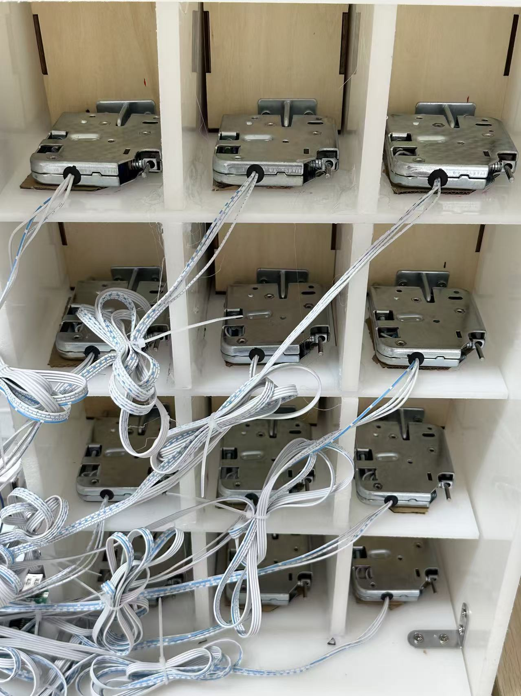 |
| 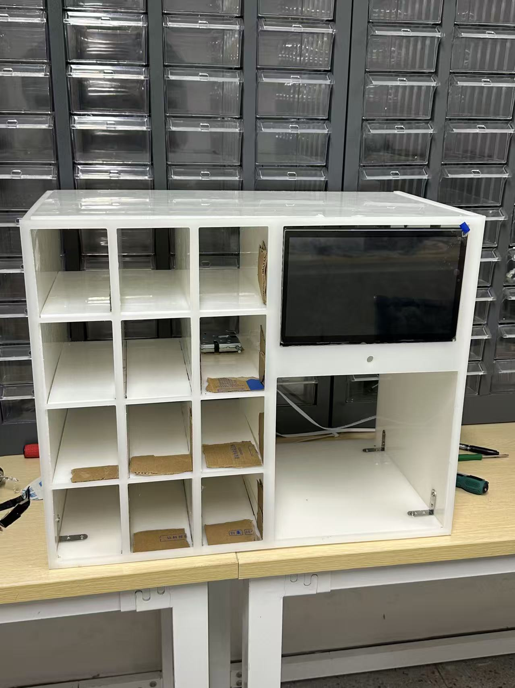 | 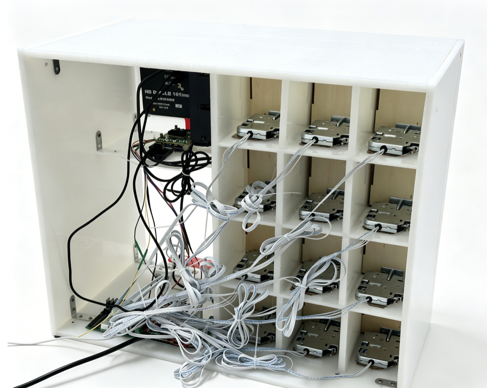 |

</details>

## 接线与上电检查

接线示意和实物位置：

| K1 与锁控板 | 摄像头与屏幕/外围设备 |
| --- | --- |
| 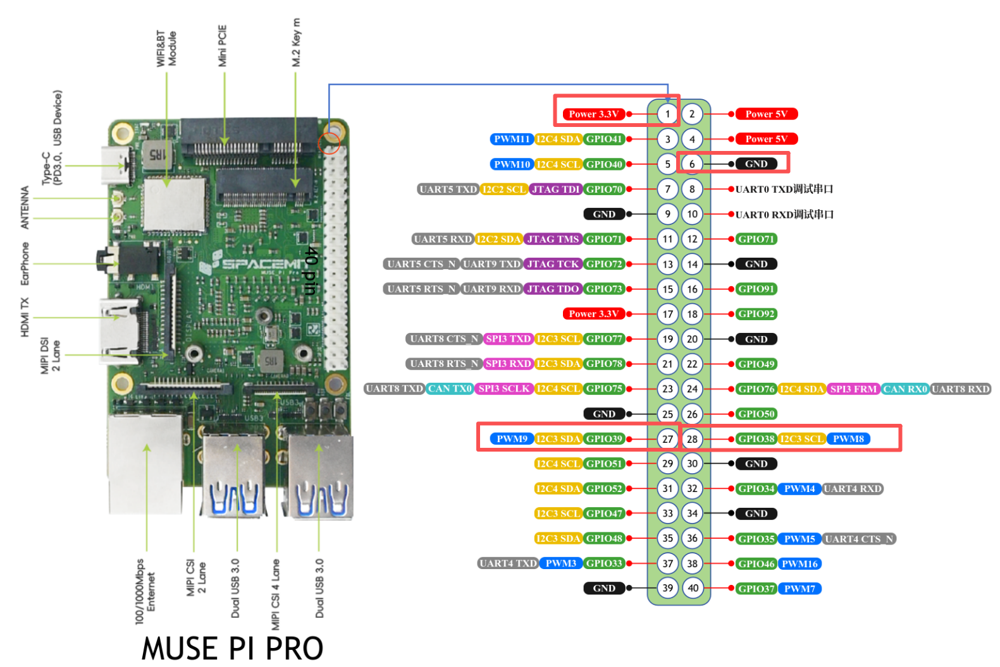 | 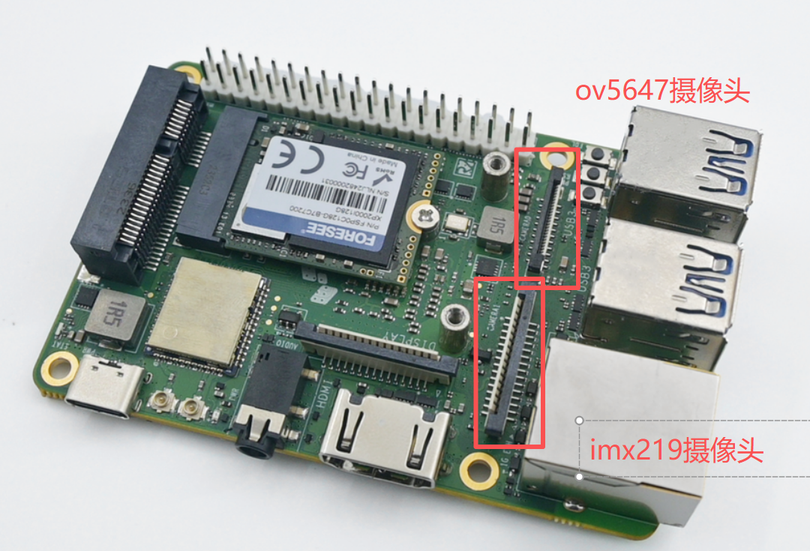 |
| 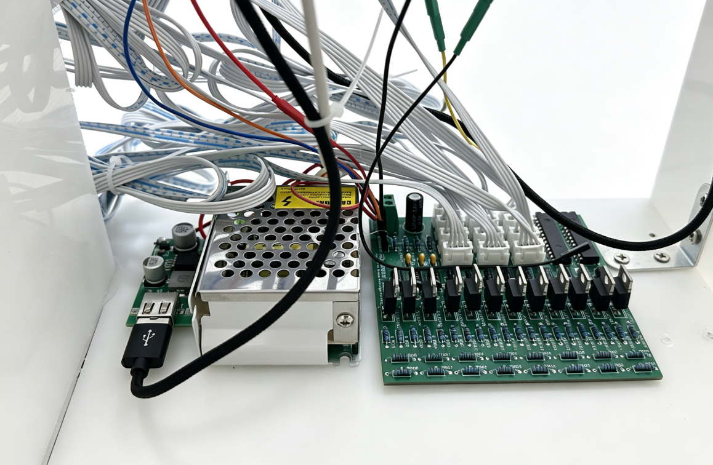 | 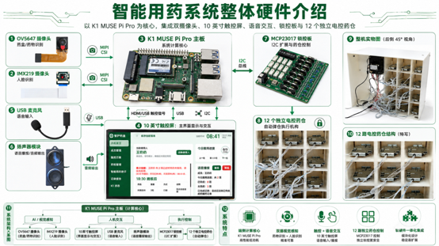 |

相机固定位置见 [OV5647 安装图](图片/ov5647摄像头通过开发板平台的小圆孔固定在识别区正上方.png) 和 [IMX219 安装图](图片/imx219通过胶带固定在前面板预留的孔位上.png)。柜体后部实物走线见[后部布线照片](图片/线路图.png)。

> **上电安全：** 220 V AC 侧存在触电和起火风险。使用合规隔离电源并将市电端可靠封闭；市电接线应由具备相应经验的人员完成。所有低压连线均应在断电状态下进行。杜邦线连接前，必须同时核对 K1 板卡版本、40-pin 物理编号、锁控板原理图和信号电平；不要仅按网上通用引脚图接线。柜锁使用独立电源时，按电路设计确认共地/隔离要求，禁止把 12 V 接到 K1 GPIO/I²C 信号脚。

当前代码中的药柜控制默认使用 I²C bus 3，MCP23017 输出地址 `0x20`、反馈地址 `0x21`。这描述的是软件配置，不能替代 PCB 原理图或实物接线确认。

## 核心技术与展示资料

- [核心技术亮点及跑分数据（PDF）](核心技术亮点及跑分数据.pdf)
- [锁控板原理图（PDF）](PCB资料/Schematic_New-Project_2026-10-20.pdf)
- [锁控板物料清单（BOM）](PCB资料/BOM_New-Project_2026-10-20.csv)
- [锁控板 Gerber 制造文件](PCB资料/Gerber_New-Project_PCB_New-Project_2026-10-20.zip)
- [PCB 原理图图片](图片/PCB原理图.png) · [PCB 版图图片](图片/PCB版图.png)
- [处方笺 OCR 演示模板（PDF）](处方笺模板/处方笺.pdf)

## 新 K1 开发板部署

目标环境为进迭时空 K1 MUSE Pi Pro 和兼容的 Bianbu Linux。首次部署需先准备匹配的 K1 BSP、相机驱动/配置及 SpaceMIT 推理运行时；Git 仓库不会自动安装这些板级系统组件。请按[新板复现指南](docs/NEW_BOARD_SETUP.md)安装和检查依赖，不要用通用 `pip install` 覆盖厂商版 ONNX Runtime 或 OpenCV。

### 克隆并检查项目

```bash
sudo apt update
sudo apt install -y git git-lfs
git lfs install
git clone https://github.com/AnsoWang924/spacemit-k1-smart-medicine-box.git
cd spacemit-k1-smart-medicine-box
git lfs pull
python3 deployment/preflight.py
```

### 安装核心服务并打开界面

先按新板指南配置板端依赖、USB 音频设备角色、摄像头和锁控板，再安装当前用户的核心服务：

```bash
bash deployment/install-user-services.sh
bash deployment/health-check.sh
```

在 K1 本机浏览器打开 `http://127.0.0.1:8799/ui/`。如果从电脑通过 SSH 访问，建立本地端口转发：

```bash
ssh -L 8799:127.0.0.1:8799 <K1用户名>@<K1地址>
```

然后在电脑浏览器打开 `http://127.0.0.1:8799/ui/`。需要开机全屏显示时，按指南配置图形会话和 kiosk 服务。语音输入依赖 K1 上的 SpaceMIT ASR 运行环境；语音合成使用联网服务时需要互联网连接。

完整安装顺序、系统依赖表、相机配置、USB 音频配置、服务启动和排障命令见 [`docs/NEW_BOARD_SETUP.md`](docs/NEW_BOARD_SETUP.md)。依赖来源和已知版本见 [`docs/DEPENDENCIES.md`](docs/DEPENDENCIES.md)。

## 验证状态与限制

归档目录已通过静态文件预检，检查必需运行文件、配置语法、模型哈希和界面音频引用。该检查不等同于在干净镜像的新 K1 上从零完成安装，也不覆盖摄像头成像、麦克风录音、扬声器播报、药仓电气动作或整机流程验收。当前 K1 运行快照与本地候选目录的比对和未验证项记录在[发布审查](docs/RELEASE_AUDIT.md)及[硬件状态](docs/HARDWARE.md)中。

本项目用于工程演示和技术研究，不作为医疗器械或自动处方工具。用户必须核对 OCR 识别结果和所有用药建议；药物选择、剂量调整和治疗决策应咨询医生或药师。

## 项目结构

| 路径 | 内容 |
| --- | --- |
| `backend/gateway` | API 网关、流程协调、OCR/设备服务 |
| `backend/qa` | 药物问答 API、本地知识数据和检索模型 |
| `backend/llm`、`models/llm` | 端侧大模型启动器、配置和 GGUF 模型 |
| `backend/medicine_box_recognition`、`backend/medicine_prescription_ocr` | 药盒与处方 OCR |
| `backend/pill_detection`、`backend/face` | 药品数量识别和人脸识别 |
| `backend/cabinet`、`backend/scheduler` | 药柜控制与服药计划调度 |
| `backend/voice`、`backend/audio` | ASR/TTS 接口及 USB 音频设备角色管理 |
| `frontend` | Web UI、API 客户端和语音提示素材 |
| `图片`、`PCB资料` | 项目展示图、装配/接线图片、PCB 制造资料 |
| `deployment` | 用户级 systemd 服务、启动脚本、健康检查和静态预检 |
| `docs` | 新板部署、依赖、硬件与发布审查说明 |

## 相关文档

- [新板 0–1 复现指南](docs/NEW_BOARD_SETUP.md)
- [硬件状态与实测边界](docs/HARDWARE.md)
- [软件依赖清单](docs/DEPENDENCIES.md)
- [第三方组件与素材来源记录](docs/THIRD_PARTY_NOTICES.md)
- [GitHub 仓库创建与首次发布指南](docs/GITHUB_PUBLISH.md)

